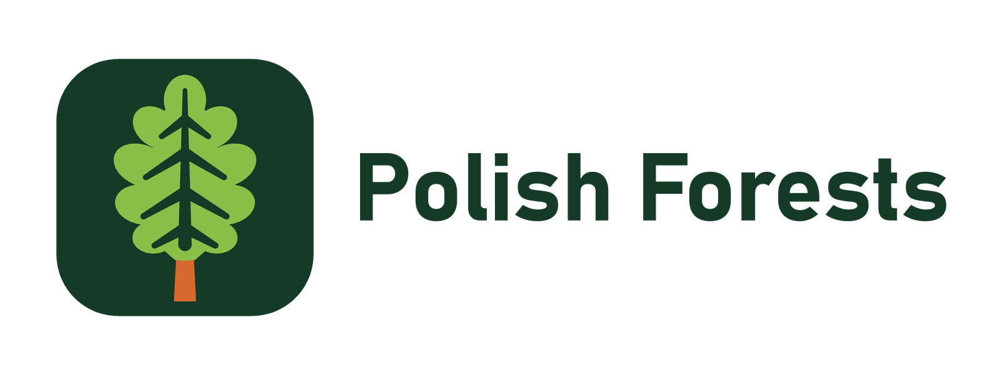

# Polish Forests (dawniej „Przyrodniczo zgodne lasy”)

<p align="center"></p>

Mod do Minecrafta 26.3 (Fabric), który generuje proceduralne krajobrazy Polski w skali 1:1 z przyrodniczo wiernymi lasami, florą i fauną oraz integracją z porami roku Serene Seasons.

Stan (2026-10-14): za nami M0, M1, skala rozgrywki, etap rzek, dolin i morza oraz M2 (biomy, siedliska, gleby i temperatura, kroki S0–S10). Świat ma 36 własnych biomów, strefy nadwodne, piętra Beskidów z kosodrzewiną i halą, gleby i półkę brzegową, zastępczą roślinność z płynnymi przejściami między siedliskami, tryb „dzisiejsza Polska” i komendy szukania biomów i stref. Budżety wydajności i determinizm generacji (także z C2ME) są sprawdzone. Na akceptację użytkownika czekają zrzuty punktów kontrolnych i pięć decyzji (`docs/00-decyzje-do-podjecia.md` E). Następny etap to pionowy wycinek: jeden kompletny las z drzewami, runem, martwym drewnem i kilkoma zwierzętami. Kod i teksty w grze są po angielsku (polski jako tłumaczenie), dokumentacja po polsku. Licencja: kod na MIT, grafika i inne zasoby na CC BY 4.0 (niżej). Plan i decyzje są w katalogu `docs`.

## Dokumentacja

| Plik | Zawartość |
|---|---|
| `docs/00-decyzje-do-podjecia.md` | decyzje projektowe, podjęte i otwarte |
| `docs/01-architektura.md` | architektura i kamienie milowe |
| `docs/02-wydajnosc.md` | pomiary wydajności, zalecana paczka modów i ustawienia |
| `docs/03-m2-biomy.md` | plan kamienia milowego M2: 36 biomów, strefy nadwodne, piętra, gleby, temperatura |
| `docs/research/` | raporty badawcze: geografia, lasy, fauna, klimat, technika |
| `docs/m1/` | podglądy modelu krajobrazu i zrzuty ekranu z gry po M1 |
| `docs/rzeki-i-morze/` | podglądy i zrzuty po etapie rzek, dolin i morza |
| `docs/m2/` | podglądy siedlisk M2, udziały biomów i stref, pomiary bazowe |

## Wymagania

- JDK 25 lub nowszy (projekt kompiluje się z `--release 25`, np. zainstalowanym JDK 26).
- Gradle nie jest potrzebny, bo projekt zawiera wrapper.

## Polecenia

Wszystkie polecenia uruchamia się w katalogu projektu. Gradle sam używa JDK wskazanego w `gradle.properties` przez `org.gradle.java.home`, niezależnie od domyślnej Javy w systemie. Na innym komputerze trzeba tam wpisać ścieżkę do własnego JDK 25 lub nowszego.

```bash
./gradlew build
```

Kompiluje mod i uruchamia testy jednostkowe modelu krajobrazu. Gotowy plik jest w `build/libs`.

```bash
./gradlew fastTest    # szybkie testy (bez klas oznaczonych @Tag("slow")), ok. 1 min
./gradlew test        # wszystkie testy oprócz pomiaru kosztu, w 3 równoległych procesach
./gradlew costTest    # pomiar kosztu SampleCostTest, sam w jednej JVM
```

Zasady pracy, testy i skrypt `tools/dev/run-tests` (ponowne użycie wyników przy niezmienionym drzewie) opisuje `docs/BRIEF.md`.

```bash
./gradlew landscapePreview
```

Renderuje model krajobrazu do `build/preview/*.png` bez uruchamiania gry i wypisuje statystyki nachyleń gór.

```bash
./gradlew runClientGameTest -Pgametest=all
```

Uruchamia prawdziwego klienta i testy w grze, a zrzuty ekranu zapisuje do `build/run/clientGameTest/screenshots`. Zamiast `all` można podać `ui` (ekran opcji i komendy), `performance` (porównanie z wanilią), `views` (przegląd krajobrazów), `stages` (czasy etapów generacji chunka), `climate` (temperatura i śnieg w obu skalach), `habitats`, `vegetation`, `present_day` (siedliska, roślinność i tryb „dzisiejsza Polska”), `determinism` (ten sam świat z tego samego ziarna) albo `ecotones` (zrzuty granic biomów, tylko z nazwy). Dopisek `-Psites=beach,cliff` ogranicza widoki do wybranych miejsc (nazwy w `PolandWorldClientGameTest`).

```bash
python tools/build_mrpack.py
```

Po `./gradlew build` buduje zalecaną paczkę modów `.mrpack` w `build/distributions`.

```bash
./gradlew runClient
```

Uruchamia grę w trybie deweloperskim. Z flagą `-Poptimization` dołącza mody z zalecanej paczki, z `-PtreeFelling=fallingtree` albo `-PtreeFelling=treeharvester` mod do ścinania całych drzew (krok G1; test w grze: `./gradlew runClientGameTest -Pgametest=slice -Psites=felling -PtreeFelling=…`).

```bash
python tools/art/generate.py   # albo ./gradlew generateArt
./gradlew checkArt
```

Tekstury bloków powstają proceduralnie w `tools/art` (przepisy gatunków, palety ze zdjęć CC0 i z domeny publicznej, lint stylu), a modele zwierząt GeckoLib (`.geo.json`, animacje, tekstury i jaja przyzywające) w `tools/fauna` (opis gatunku w centymetrach, podgląd z kodu: `python tools/fauna/sheet.py`). Dźwięki (pejzaż lasu i głosy zwierząt) syntetyzuje `tools/sound` (przepisy w Pythonie z NumPy, kodowanie do OGG Vorbis: `./gradlew generateSound`; `./gradlew checkSound` porównuje pliki z generatorem po zdekodowaniu i sprawdza manifest licencji). `generateArt` zapisuje je do `src/main/resources/assets/polishforests/` razem z `CREDITS.md`, a `checkArt` sprawdza, czy pliki w repozytorium są dokładnie tym, co dają generatory, i czy przechodzą lint i walidator. Oba zadania potrzebują Pythona 3.10+ z Pillow i NumPy (`pip install pillow numpy`) i nie wchodzą do `build`; inny interpreter wskazuje `-Ppython=<ścieżka>`.

## W grze

Świat tworzy się na zakładce „Świat”. Do wyboru są dwa typy świata:

| Typ świata | Krajobrazy | Wysokości | Dla kogo |
|---|---|---|---|
| Poland (1:1 Scale), po polsku „Polska (skala 1:1)”, `polishforests:poland` | rzeczywiste, makroregiony ok. 64 km | 1:1 do ok. 900 m, Rysy na Y 2000 | wierność i dalekie wyprawy |
| Poland (Gameplay Scale), po polsku „Polska (skala rozgrywki)”, `polishforests:poland_gameplay` | ok. 1,4 km, ok. 2 razy więcej niż biom wanilijny | obniżone proporcjonalnie, Rysy na Y ok. 690 | zwykła gra, słabszy komputer |

Przycisk „Dostosuj” otwiera opcje generowania: skalę, rozmiar regionów, tryb krajobrazu, udział lasów gospodarczych, pokrywę osadów (cienka: na nizinach 4–10 bloków gleby, piasku albo gliny nad kamieniem, domyślna; realistyczna: dziesiątki bloków, jak w światach sprzed tej opcji), jaskinie (jak w zwykłym Minecrafcie, domyślnie włączone; światy sprzed tej opcji są bez jaskiń) i gatunki obce.

| Komenda | Działanie |
|---|---|
| `/polishforests find <target>` | najbliższy krajobraz lub forma terenu z klikalnymi współrzędnymi |
| `/polishforests list` | klikalna lista celów `find` w grupach (krajobrazy, piętra górskie, wody, wybrzeże, formy terenu, Tatry, szczegóły Tatr, dno lasu) oraz biomów i stref |
| `/polishforests find biome <biom>`, `find zone <strefa>` | najbliższe siedlisko (np. `oak_hornbeam_forest`, `fresh_pine_forest`) albo strefa (np. `bare_rock`) |
| `/polishforests find anthill` | najbliższe mrowisko rudnicy w borze; we wczytanym chunku kopiec, który tam stoi, w niewczytanym pozycja z planu (po teleporcie ponowne `find anthill` wskaże stojący kopiec) |
| `/polishforests elevation <from> <to>` | najbliższy teren o wysokości w przedziale, w m n.p.m. |
| `/polishforests highest [radius_km]` | najwyższy punkt w okolicy |
| `/polishforests here` | krajobraz, wysokość, podłoże, wody i formy terenu pod graczem |
| `/polishforests fauna [radius]` | zwierzęta moda i wanilii w promieniu (domyślnie 64 bloki) według gatunku i stanu |

### Zwierzęta i dźwięki lasu

Zwierzęta moda żyją w lasach moda w obu typach świata „Polska” i w „Default + Polish Forests”, w obu skalach (zwierzęta zawsze w naturalnej wielkości) i obu trybach roślinności. Pojawiają się przy generacji chunka i ze spawnera fauny wokół graczy, w gęstości ok. 20–50 razy większej niż w polskich lasach (inaczej gracz prawie by ich nie spotkał); znikają tylko dalej niż 128 bloków od gracza, nigdy z imieniem ani na smyczy. Zwierzęta wanilii (wilk, lis, królik, żaba) zostają w lasach bez zmian. Sarna, dzik, wiewiórka i sójka mają jaja przyzywające.

| Zwierzę | Gdzie i jak żyje |
|---|---|
| Sarna (`polishforests:roe_deer`) | wszystkie lasy, najwięcej grądy, łęgi i bory mieszane; rytm dnia (żer o świcie i zmierzchu, odpoczynek w gęstwinie), latem pojedynczo albo z koźlętami, zimą w grupach, futro i parostki według pory roku; ucieka przed graczem ze szczekiem i alarmuje inne zwierzęta |
| Dzik (`polishforests:wild_boar`) | lasy liściaste i mieszane, łęgi i olsy (tarzanie w błocie przy wodzie); watahy z lochą i warchlakami, odyńce pojedynczo, rytm nocny; locha z młodymi szarżuje ostrzegawczo bez obrażeń; ryje buchtowiska |
| Wiewiórka pospolita (`polishforests:red_squirrel`) | bory i lasy mieszane, świerczyny, rzadziej grądy; wspina się po pniach i skacze między koronami, żeruje z szyszką, zimą z pędzelkami na uszach |
| Sójka (`polishforests:eurasian_jay`) | grądy, buczyny i lasy mieszane, rzadziej bory; lata pod koronami, siada na gałęziach, jesienią chowa żołędzie; skrzeczy na widok gracza i płoszy sarny i dziki |
| Żaba trawna | wariant żaby wanilii (`polishforests:common_frog`) przy wodzie w olsach, łęgach i przy kałużach w lasach; zimą spawner nie dodaje żab |

Pejzaż dźwiękowy lasu: śpiew ptaków (zięba, kos, rudzik, bogatka, sosnówka, mysikrólik, kukułka), bębnienie i głos dzięcioła, pohukiwanie puszczyka nocą, skrzek sójki; o świcie i zmierzchu gęściej, zimą ciszej. Do tego szczek sarny, chrząkanie i chrapnięcie dzika i rechot żaby trawnej. Wszystkie dźwięki są syntezowane przez `tools/sound` (bez nagrań), z napisami po angielsku i polsku; głośność reguluje suwak „Otoczenie/Środowisko”.

| Reguła gry | Domyślnie | Działanie |
|---|---|---|
| `polishforests:forest_fauna` | `true` | zwierzęta moda (spawn przy generacji i spawner); wyłączona: nowe się nie pojawiają, istniejące zostają |
| `polishforests:boar_rooting` | `true` | dziki ryją buchtowiska (płaty ziemi gruboziarnistej i ukorzenionej); wyłącza je też `mob_griefing false` |
| `polishforests:forest_ambience` | `true` | pejzaż dźwiękowy lasu (zwierzęta zostają) |

### Drewno, łodzie i mrowiska

Gatunki drzew moda z własnym drewnem mają pełny zestaw wyrobów: kłody, drewno, okorowane pnie, deski, schody, płyty, płoty, furtki, płyty naciskowe, przyciski, drzwi, klapy, półki, tabliczki i tabliczki wiszące, łodzie i łodzie ze skrzynią (w zakładkach i książce receptur obok wyrobów wanilii). Tekstury desek i wyrobów z nich gra liczy przy wczytywaniu zasobów z tekstur wanilii (przebarwienie), więc w modzie nie ma pikseli Minecrafta.

Mrowiska rudnicy (kopce z igliwia, 1–2 bloki wysokości) stoją na skrajach borów, w lukach i w widnych starych borach, w lesie mieszanym rzadko. Łopata zbiera je warstwami, stawiane warstwy rosną jak śnieg, mrowisko się pali; za dnia od kwietnia do października po kopcu chodzą mrówki.

Do M2-9 komendy i cele miały polskie nazwy (`/polskielasy znajdz <cel>` itd.); zestawienie dawnych nazw jest w `docs/01-architektura.md`, sekcja 14.

Cele:
- krajobrazy: outwash_plain, moraine_plateau, old_glacial_plain, foothills, beskids, sea, coastland;
- piętra górskie: lower_montane, upper_montane;
- wody i mokradła: river, lake, tunnel_valley_lake, kettle_pond, peatland, stream, headwaters, oxbow_lake, lagoon, river_mouth;
- wybrzeże morskie: beach, coastal_dunes, cliff;
- formy terenu: river_valley, valley_slope, tunnel_valley, inland_dunes, end_moraine, ridge, summit, mountain_pass, mountain_valley;
- Tatry (w światach z Tatrami): tatra, high_tatra, western_tatra, podhale, tatra_foreland, foreland_gorge, cirque, u_valley, tarn, pinnacle, gully, scree, moraine, snow_patch;
- szczegóły Tatr: karst_spring, cave_mouth, waterfall, shepherd_hut (szałasy tylko w trybie „dzisiejsza Polska”);
- dno lasu: anthill.

Rzeki meandrują zależnie od spadku terenu, zostawiają starorzecza i uchodzą do morza. Wybrzeże ma plaże, klify, wydmy i zalewy.

Informacje o krajobrazie są też na ekranie F3.

## Zależności

| Mod | Wersja | Status |
|---|---|---|
| Fabric API | 0.161.0+26.3 | wymagany |
| GeckoLib | 5.5.7 | wymagany |
| SmartBrainLib | 2.0.3 | wymagany |
| Serene Seasons | 26.1.2.0.7 | opcjonalny, bez niego działa własny kalendarz |
| FallingTree | 26.3-26.3.0.4 | opcjonalny, ścina całe drzewo jednym cięciem (w paczce `.mrpack` jako opcjonalny) |
| Tree Harvester (+ Collective) | 26.3.0-10.3 | opcjonalny, ścina całe drzewo jednym cięciem (w kucki) |

Nowy świat zaczyna się późną wiosną (maj). Własny kalendarz moda ma 12 dni gry na podsezon. Z Serene Seasons ten sam start i długość roku daje plik `config/sereneseasons/seasons.toml` z `starting_sub_season = 3` i `sub_season_duration = 12` w sekcji `[time_settings]`; paczka `.mrpack` go zawiera (`tools/modpack/config/`).

Mody do ścinania całych drzew (krok G1): FallingTree i Tree Harvester ścinają drzewa moda po grafie „rodziców” cienkich pni (klasa zgodności ładowana tylko z modem, bez twardej zależności): całe drzewo z gałęziami i nabiegami, bez sąsiednich drzew, krzewów i korzeni w gruncie; martwe drewno (kłody, wykroty) — po jednym bloku. Odcięte liście moda opadają same w ciągu 1–3 s, liście trzymane przez sąsiednią koronę zostają. FallingTree domyślnie nie ścina drzew większych niż 100 bloków drewna, a drzewa moda mają ich do ok. 360: zalecana konfiguracja `tools/modpack/config/fallingtree.json` (w paczce `.mrpack`) podnosi limit do 2048, zrzuca łup w miejscu cięcia i zmniejsza zużycie siekiery (0,2 na blok). Tree Harvester nie ma limitu; zużywa 1 punkt siekiery na blok drewna (w jego konfiguracji `loseDurabilityModifier` można to zmniejszyć) i sadzi sadzonkę u podstawy. Grube drewno daje kłody, cienkie gałęzie patyki; drągowina — także drzewo wyrosłe z sadzonki moda — daje same patyki, bez kłód (`docs/00` G.25 G1-j, pytanie do CP-C). Wyniki testu w grze: `docs/04-pionowy-wycinek.md`, „Stan po G1”.

## Licencja

Kod (Java, skrypty budowania, narzędzia, w tym `tools/art` i `tools/fauna`) jest na licencji MIT (`LICENSE`). Zasoby moda, czyli tekstury, modele, animacje i dźwięki w `src/main/resources/assets/polishforests/` i `src/main/generated/assets/polishforests/`, są na licencji Creative Commons Uznanie autorstwa 4.0 (CC BY 4.0, `LICENSE-assets`): można je wykorzystywać i przerabiać, także w innych modach i paczkach zasobów, z podaniem autorstwa („Polish Forests by SernikNaZimno” z odnośnikiem do repozytorium). `CREDITS.md` wymienia źródła zewnętrzne (zdjęcia CC0 i z domeny publicznej, z których mierzono same kolory palet) i opisuje dźwięki, wszystkie syntetyzowane przez `tools/sound`, bez nagrań. Mod nie zawiera plików Minecrafta: do tekstur i modeli wanilii odwołuje się tylko po identyfikatorach, a tekstury desek i wyrobów z drewna moda (drzwi, klapy, półki, tabliczki, łodzie) liczy klient gry z tekstur wanilii gracza przy wczytywaniu zasobów, więc nie są plikami moda ani nie obejmuje ich licencja zasobów. Obie licencje są też w pliku moda (`LICENSE_polishforests`, `LICENSE-assets_polishforests`, `CREDITS_polishforests.md`).

## Logo

Znak: liść dębu szypułkowego z wyciętym w nerwach świerkiem, na pniu w kolorze kory sosny. Pliki w `docs/logo/` (logo poziome i pionowe, na jasne i ciemne tło, bez hasła; znak w SVG), ikona moda w `src/main/resources/assets/polishforests/` (16–512 px; 16 i 32 px rysowane ręcznie jako pixel art). Źródła: `tools/logo/` (`python tools/logo/build.py`, czcionka Bahnschrift z Windows).
